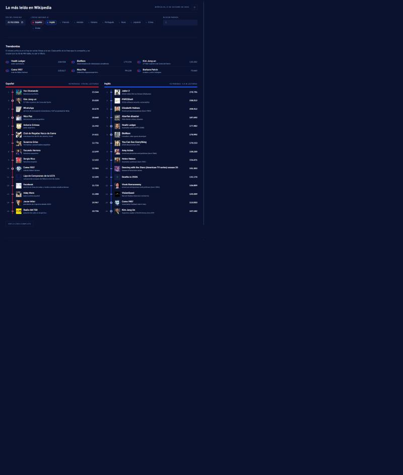

# Lo más leído en Wikipedia

Qué está leyendo el mundo hoy en Wikipedia, idioma por idioma, y qué artículos
están arriba en varios idiomas a la vez.



## Qué hace

- Ranking diario de los artículos más leídos, hasta en 4 idiomas en paralelo.
- **Coincidencias entre idiomas**: el mismo artículo en el top de varios idiomas,
  cruzado por su ID de Wikidata.
- Evolución de 5 días por artículo, en una sparkline junto a cada cifra.
- Cualquier día desde 2016, buscador sobre el ranking y tema claro u oscuro.

## La decisión técnica que lo sostiene

El cruce entre idiomas parece lo obvio, pero por título no funciona: el mismo
artículo es `Kim Jong-un` en español y `Kim Jong Un` en inglés, y en japonés no
se parece en nada. Mirando la respuesta real de la API apareció el campo
`wikibase_item`, el ID de Wikidata, que sí es el mismo concepto en todos los
idiomas. Agrupando por ahí, la comparación entre idiomas pasa de ser un
problema de normalizar texto a un `Map` de una línea.

Dos cosas más que decidí no construir:

- **Sin backend.** La API de Wikimedia no pide clave y sirve CORS abierto, así
  que el navegador la llama directamente. Un servidor intermedio solo habría
  añadido una pieza que mantener y un punto más donde fallar.
- **Sin librería de gráficas.** Las sparklines son 5 puntos. Son 20 líneas de
  SVG en vez de 50 KB de dependencia.

## El sistema visual

**Cada idioma es una línea de una red; un artículo leído en varias es un
transbordo.** Esa frase es todo el diseño. Una línea continua del color de su
idioma recorre cada columna por detrás de los artículos, y cada artículo es una
parada sobre ella: marca perpendicular si solo lo lee ese idioma, anillo si lo
comparten varios. Arriba, un artículo compartido lleva un anillo concéntrico por
cada línea que lo lee, y se entiende sin leyenda.

Esmalte medianoche `#0B1230` en toda la pantalla, porcelana para el texto y diez
tintas de línea saturadas. Tipografía Overpass, que desciende de la Highway
Gothic de la señalética de carreteras, con las cifras alineadas por
`font-variant-numeric`. Una sola familia, ninguna monoespaciada.

**El color nunca decora:** identifica el idioma, la selección y el estado. La
fila de botones acaba siendo la leyenda de todo lo que hay debajo.

**Un solo momento con movimiento:** la línea de cada columna se traza al llegar
los datos. Nada más se mueve, y bajo `prefers-reduced-motion` no se mueve nada.

Los contrastes están medidos en el navegador componiendo el alfa, no estimados:
texto 18:1, secundario 7:1, cifras 5:1, y las diez tintas por encima de 3:1
sobre su fondo en los dos temas.

## Dos trampas de los datos

- **El `rank` de la API trae huecos** (4, 5, 6, 8...) porque Wikipedia descuenta
  la portada y las páginas especiales pero conserva el número original. Mostrar
  ese campo tal cual hace que el ranking empiece en 4 y parezca un bug, así que
  la interfaz numera por posición en la lista.
- **El feed de un día publica el ranking del día anterior.** Internamente se
  consulta la fecha siguiente a la que pide el usuario, para que la fecha de la
  pantalla no mienta. Por eso el día más reciente consultable es ayer.

## Arrancarlo

```bash
pnpm install
pnpm dev
```

| Comando | Qué hace |
| --- | --- |
| `pnpm dev` | Servidor de desarrollo en `localhost:5173` |
| `pnpm build` | Comprobación de tipos y build de producción |
| `pnpm test` | Tests del cruce entre idiomas y del cálculo de fechas |
| `pnpm lint` | oxlint |

## Stack

React 19, TypeScript, Vite y Tailwind v4. Tipografía Overpass, autoalojada. Los
tests corren con el runner nativo de Node 24, que ejecuta TypeScript sin
compilar: cero dependencias de testing.

## Datos

[Feed API de Wikimedia](https://api.wikimedia.org/wiki/Feed_API/Featured_content),
sin clave ni autenticación. Las cifras son lecturas de página, no visitantes
únicos. Contenido de Wikipedia bajo CC BY-SA 4.0.

## Licencia

MIT
